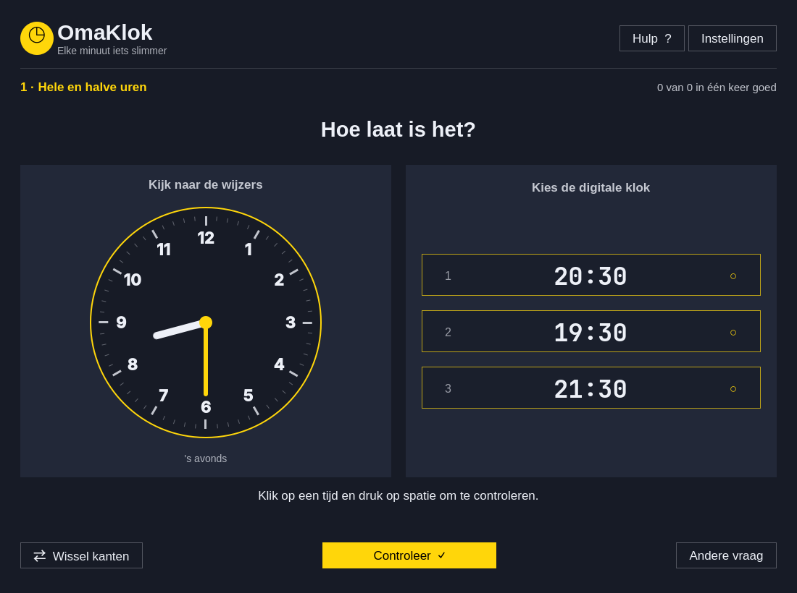

# OmaKlok

Spelenderwijs leren klokkijken voor Nederlandse kinderen van 5–10 jaar. Een native Qt Quick desktopapp voor Linux/Omarchy, met een Omarchy shellplugin om hem vanuit de balk te openen.

- Lees een analoge klok en kies uit **3, 4 of 5 digitale tijden**.
- Zet zelf de wijzers met muis of toetsenbord, of wissel beide oefenvormen af.
- Verwissel de analoge en digitale kant met één knop.
- Vijf niveaus: hele/halve uren, kwartieren, vijf minuten, elke minuut en tijdverhalen.
- Verhalen over eten, school, speelafspraken, handen wassen, dansles, zwemles en bedtijd.
- Een hulpboekje legt Nederlandse kloktaal uit, inclusief **half zeven = 6:30** en **18:00 = zes uur 's avonds**.
- Leest het actuele Omarchy-thema en volgt wijzigingen live, ook lichte thema's en vensterafronding.
- Werkt offline, zonder accounts, advertenties, tracking of netwerkverzoeken. Alleen oefeninstellingen worden lokaal bewaard; de sessiescore verdwijnt bij afsluiten.

De app blijft bewust Nederlands, ook wanneer de desktop op een andere taal staat. Digitale tijden gebruiken 24 uur. Bij het zetten van een klok kiest het kind ook voor of na de middag. Alleen de eerste poging per vraag telt voor de score; opnieuw proberen blijft mogelijk.

## Installeren op Omarchy

Benodigd: `base-devel qt6-base qt6-declarative qt6-wayland qt6-svg` (normaal al aanwezig op Omarchy).

```sh
git clone https://github.com/bwag84/OmaKlok.git
cd OmaKlok
bin/install
```

Dit bouwt een Arch-pakket en installeert het met `makepkg -fsi`. Start daarna **OmaKlok** vanuit de appstarter (`Super + Space`), of voer `omaklok` uit.

Zonder sudo kan het ook:

```sh
bin/install-user
```

Dit plaatst de binary in `~/.local/bin`, en de launcher en het pictogram in `~/.local/share`. Zorg dat `~/.local/bin` op `PATH` staat. Een pakket bouwen zonder installatie: `cd pkgbuild && makepkg -f`.

## Omarchy shellplugin

**Installeer eerst de desktopapp hierboven.** De shellplugin is een kleine launcher, geen tweede versie van het oefenprogramma. Hij bouwt of installeert niets automatisch en meldt het wanneer de binary ontbreekt.

```sh
omarchy plugin add https://github.com/bwag84/OmaKlok.git --enable
```

Klik daarna op **◷ OmaKlok** in de balk. Je kunt ook openen via:

```sh
omarchy-shell shell summon bwag84.omaklok
```

Dit is een communityplugin; een vermelding in de officiële marketplace wordt apart aangevraagd en betekent geen officiële Omarchy-goedkeuring van de app.

## Oefenniveaus

| Niveau | Wat oefen je? |
| --- | --- |
| 1 | Hele en halve uren |
| 2 | Ook kwart over en kwart voor |
| 3 | Alle stappen van vijf minuten, ook voor/over half |
| 4 | Alle losse minuten |
| 5 | Vooruitrekenen in herkenbare verhaaltjes, ook over een uur of middernacht heen |

Kies in **Instellingen** een niveau, oefenvorm en aantal antwoorden. De instructies en antwoorden blijven staan totdat het kind op **Controleer** drukt. Na een juist antwoord gaat spatie naar de volgende vraag. **Andere vraag** slaat een oefening over zonder een poging te tellen.

## Toetsen

| Toets | Actie |
| --- | --- |
| Spatie / Enter | Antwoord controleren; na succes de volgende vraag |
| 1–5 | Digitaal antwoord kiezen |
| M / U | Grote minutenwijzer / kleine uurwijzer kiezen |
| ← / → | Gekozen wijzer één minuut / uur terug of vooruit |
| ↑ / ↓ | Minutenwijzer vijf minuten vooruit / terug; uurwijzer één uur vooruit / terug |
| Tab / Shift+Tab | Knoppen en instellingen doorlopen |
| ? | Hulp en toetsenoverzicht |
| Q | Afsluiten |

Bij de muisbediening kies je eerst **Grote wijzer** of **Kleine wijzer** en klik/sleep je naar de gewenste stand op de klok. De kleine wijzer schuift vanzelf met de minuten mee. De knop voor het dagdeel wisselt tussen 00–11 en 12–23 uur.

## Ontwikkelen en testen

```sh
bin/build
bin/test
omarchy plugin validate .
QT_QPA_PLATFORM=offscreen QT_QUICK_BACKEND=software build/omaklok --screenshot docs/screenshot.png
```

C++ beheert tijdrekening, oefeningen, antwoorden en instellingen; QML beheert presentatie en interactie. Qt Test controleert tijdtaal, oefengeneratie, unieke antwoorden, scoring, dagdelen, themawijzigingen en echte QML-muis/toetseninteractie. `--screenshot` gebruikt een standaardthema en schrijft geen instellingen.

Een CI-sjabloon staat in `docs/ci-check.yml`. Kopieer dit naar `.github/workflows/check.yml` met GitHub-rechten voor workflows om automatische Arch-builds te activeren.

## Verwijderen

Arch-pakket: `sudo pacman -R omaklok`. Gebruikersinstallatie:

```sh
rm ~/.local/bin/omaklok ~/.local/share/applications/omaklok.desktop ~/.local/share/icons/hicolor/scalable/apps/omaklok.svg
```

Shellplugin: `omarchy plugin remove bwag84.omaklok`. Instellingen staan afzonderlijk in `~/.config/OmaKlok/omaklok.conf`.

Zie [de publicatievoorbereiding](docs/marketplace-submission.md) voor het marketplace-concept en releaseprocedure.

MIT © 2026 Bart Wagener. Themavolging gebaseerd op Omarchy-appvoorbeelden van David Heinemeier Hansson.
